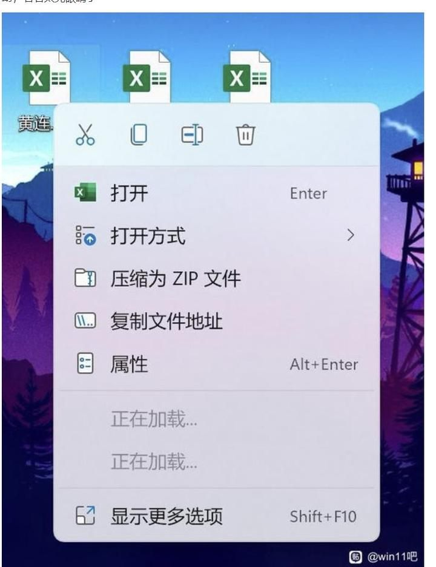

## 问题描述

当我们下载了某些软件后，右键菜单常常变得冗余，从而看起来很不舒服，如下图所示：



### 原因分析

Win11 的新版右键菜单采用了**二级菜单设计**（"显示更多选项"），当系统中安装了过多第三方软件时，这些软件会在右键菜单中注册大量菜单项。由于 Win11 的新菜单需要动态加载这些第三方菜单项，当菜单项过多或某些软件响应较慢时，就会出现"正在加载中"的提示，导致右键菜单响应迟缓，影响使用体验。

---

## 解决方案

### 方案一：切换为 Win10 传统右键菜单（推荐）

将 Win11 的新版右键菜单切换为 Win10 的传统样式，可以彻底解决"正在加载中"的问题，同时菜单响应速度更快。

#### 文件下载

- **GitHub 源码地址**：[点击访问](https://github.com/javakam/Windows-Scripts/blob/master/Win11%E6%94%B9%E7%94%A8%E4%BC%A0%E7%BB%9F%E5%8F%B3%E9%94%AE%E8%8F%9C%E5%8D%95.bat)
- **本地文件下载**：[点击下载](./images/win11-right-click/Win11改用传统右键菜单.txt)（下载后请将文件后缀改为 `.bat`）

#### 脚本内容

以下为脚本完整内容，您可以选择**下载文件**或**复制代码**：

```bat
@echo off
>nul 2>&1 "%SYSTEMROOT%\system32\cacls.exe" "%SYSTEMROOT%\system32\config\system"
if '%errorlevel%' NEQ '0' (
goto UACPrompt
) else ( goto gotAdmin )
:UACPrompt
echo Set UAC = CreateObject^("Shell.Application"^) > "%temp%\getadmin.vbs"
echo UAC.ShellExecute "%~s0", "", "", "runas", 1 >> "%temp%\getadmin.vbs"
"%temp%\getadmin.vbs"
exit /B
:gotAdmin
if exist "%temp%\getadmin.vbs" ( del "%temp%\getadmin.vbs" )


@echo off
echo. 
echo ============================================= 
echo 右键菜单类型
echo 1 (Win10旧版右键菜单)
echo 2 (Win11新版右键菜单)
echo ============================================= 

:select
set /p opt=请选择操作：
if %opt%==1 (
    echo 正在开启Win10旧版右键菜单·········
	reg add "HKCU\Software\Classes\CLSID\{86ca1aa0-34aa-4e8b-a509-50c905bae2a2}\InprocServer32" /f /ve
)
if %opt%==2 (
    echo 正在恢复Win11新版右键菜单·········
	reg delete "HKCU\Software\Classes\CLSID\{86ca1aa0-34aa-4e8b-a509-50c905bae2a2}" /f
)

@echo off
echo *************************************
echo *                                   *
echo *          重启任务管理器...        *
echo *                                   *
echo *************************************
taskkill /f /im explorer.exe & start explorer.exe

pause
```

**使用说明：**

1. 下载文件后，将文件后缀从 `.txt` 改为 `.bat`
2. 右键以管理员身份运行
3. 选择 `1` 切换到 Win10 传统右键菜单
4. 如需恢复 Win11 新版菜单，再次运行脚本选择 `2`

---

### 方案二：火绒安全专用版本

如果您使用的是火绒安全软件，可以使用以下专用版本。

#### 0、用户须知

> ⚠️ **重要提示**：电脑操作期间，因需重启资源管理器，所以会短暂黑屏/闪屏，属于正常现象。

#### 1、版本一

放到火绒安全的 `bin` 文件夹下点击执行即可：

```bat
@echo off
cd /d "%~dp0"
regsvr32 /s HrShredShell.dll
regsvr32 /s HRShell.dll
taskkill /f /im explorer.exe
start explorer.exe
echo Done.
pause
```

> **说明**：因为转换后，火绒的菜单可能会消失，使用此脚本可以重新加载火绒的右键菜单项。

---

## 补充：添加常用工具到右键菜单

### 添加 CMD 命令窗口

在文件夹右键菜单中添加"在此处打开命令窗口"选项：

```bat
Windows Registry Editor Version 5.00

# 在文件夹背景空白处右键
[HKEY_CLASSES_ROOT\Directory\Background\shell\OpenCMDHere]
@="在此处打开命令窗口(&W)"
"Icon"="cmd.exe"

[HKEY_CLASSES_ROOT\Directory\Background\shell\OpenCMDHere\command]
@="cmd.exe /s /k pushd \"%V\""

# 在文件夹图标上右键
[HKEY_CLASSES_ROOT\Directory\shell\OpenCMDHere]
@="在此处打开命令窗口(&W)"
"Icon"="cmd.exe"

[HKEY_CLASSES_ROOT\Directory\shell\OpenCMDHere\command]
@="cmd.exe /s /k pushd \"%V\""
```

**使用方法：**
1. 将上述内容保存为 `.reg` 文件
2. 双击运行导入注册表
3. 重启资源管理器或注销后生效

---

### 添加 VSCode 到右键菜单

在文件、文件夹右键菜单中添加"Open with Code"选项：

> **📝 使用前请先设置 VSCode 路径**：将下面的 `VSCODE_PATH` 变量替换为您实际的 VSCode 安装路径（例如：`C:\\Program Files\\Microsoft VS Code\\Code.exe`）

```sh
Windows Registry Editor Version 5.00

# 请将下面的 VSCODE_PATH 替换为您的 VSCode 实际安装路径
# 例如：C:\\Program Files\\Microsoft VS Code\\Code.exe
# 注意：路径中的反斜杠需要使用双反斜杠 \\ 转义

# 文件右键
[HKEY_CLASSES_ROOT\*\shell\VSCode]
@="Open with Code"
"Icon"="\"VSCODE_PATH\""

[HKEY_CLASSES_ROOT\*\shell\VSCode\command]
@="\"VSCODE_PATH\" \"%1\""

# 文件夹右键
[HKEY_CLASSES_ROOT\Directory\shell\VSCode]
@="Open with Code"
"Icon"="\"VSCODE_PATH\""

[HKEY_CLASSES_ROOT\Directory\shell\VSCode\command]
@="\"VSCODE_PATH\" \"%V\""

# 文件夹背景右键
[HKEY_CLASSES_ROOT\Directory\Background\shell\VSCode]
@="Open with Code"
"Icon"="\"VSCODE_PATH\""

[HKEY_CLASSES_ROOT\Directory\Background\shell\VSCode\command]
@="\"VSCODE_PATH\" \"%V\""
```

**使用方法：**
1. 将上述代码中所有的 `VSCODE_PATH` 替换为您实际的 VSCode 安装路径（例如：`C:\\Program Files\\Microsoft VS Code\\Code.exe`）
2. 路径中的反斜杠需要使用双反斜杠 `\\` 转义
3. 保存为 `.reg` 文件
4. 双击运行导入注册表
5. 重启资源管理器或注销后生效

> **💡 提示**：只需替换一次 `VSCODE_PATH`，所有位置会自动使用相同的路径。如果您的 VSCode 安装在默认位置，路径通常是 `C:\\Users\\您的用户名\\AppData\\Local\\Programs\\Microsoft VS Code\\Code.exe`。

---

## 总结

通过以上方法，您可以：
- ✅ 解决 Win11 右键菜单"正在加载中"的问题
- ✅ 获得更快的右键菜单响应速度
- ✅ 根据需要添加常用工具到右键菜单

如果遇到问题，欢迎在评论区留言讨论！
