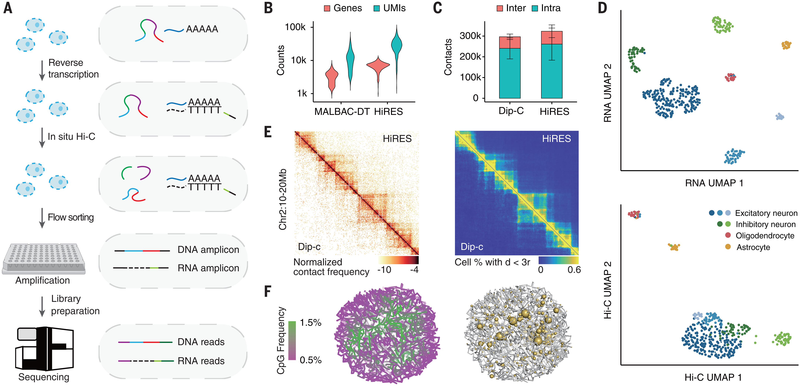
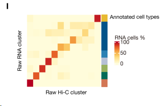
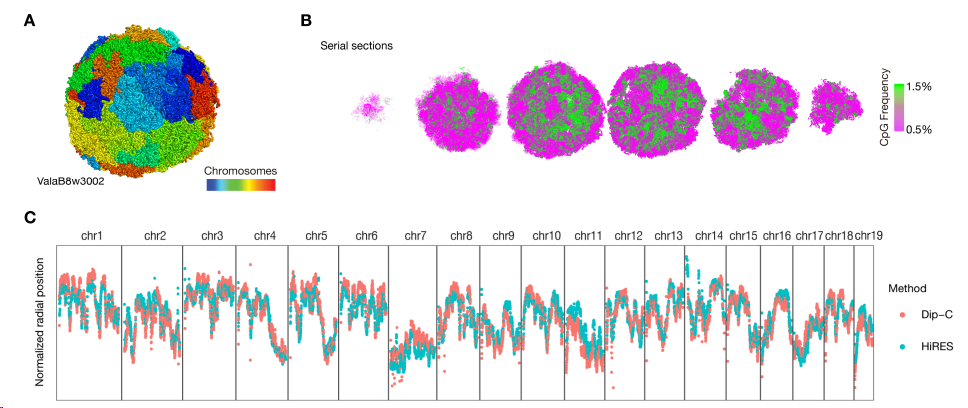
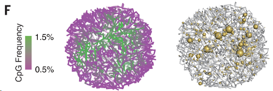

## 📌 ① HiRES — *Science*, 2023

https://www.science.org/doi/10.1126/science.adg3797

**Liu Z, Chen Y, Xia Q, et al. "Linking genome structures to functions by simultaneous single-cell Hi-C and RNA-seq." \*Science\* 380, 1070–1076 (2023)**

**亮点：** 这是首篇真正实现单细胞水平同时测量染色质三维构象和基因表达的方法论文。作者开发了 HiRES（Hi-C and RNA-seq Employed Simultaneously）技术，并应用于数千个小鼠发育胚胎单细胞。研究发现，**三维基因组结构在高度受细胞周期影响的同时，会随发育进程以细胞类型特异性方式逐渐分化**。通过比较染色质互作与转录的拟时序动态，他们发现了`广泛的"染色质重塑先于转录激活"现象`，证明特异性染色质互作与谱系分化过程中的转录调控密切相关。

- **组学组合**：scHi-C + scRNA-seq（同一细胞）
- **创新性**：首次实现两者同步，揭示"结构先于功能"的普遍规律
- **期刊**：*Science*（顶刊）

### 结合我们的课题

如其标题所说，他通过对单细胞同时测HIC和RNA-seq，来分析bin之间的互作与基因表达，是否有相关性（`HiRES技术`）。有研究分别做HIC和RNA-seq，然后把两个数据里面的细胞类型进行匹配，联合分析。但是因为他们不是来自于同一个细胞，所以这种整合`可能会错误的把3D基因组状态与转录路组状态关联起来`（而且发育中，3D结构变化不一定和转录组变化是同步的），这对于我们的课题有一定警示意义，我们就不是来自同一个细胞的。如把**还没变化的 3D 结构**配给了**已经变化的表达**，或者反过来。因此，在我们肾脏课题中，需要谨慎解释结果。

## 1、原理

图1

### 第一步：原位逆转录（In situ Reverse Transcription）

- 细胞**不裂解**，直接在细胞内部进行逆转录
- RNA → cDNA（互补DNA）
- 关键技巧：逆转录引物上带有**mRNA特异性标签**，这个标签后来用于计算机区分 RNA 和 DNA 的读段
- 细胞内同时存在：原始基因组 DNA + 新合成的 cDNA

### 第二步：原位 Hi-C（In situ Hi-C）

- 原理：空间上靠近的 DNA 片段会被交联、酶切、末端补平、生物素标记，再连接在一起
- 连接产物反映了细胞核内哪些基因组区域在空间上是"邻居"

### 第三步：流式分选（Flow Sorting）

- 将处理好的细胞**一个一个**分选到多孔板的每个孔里，保证每孔只有一个细胞，实现**真正的单细胞**分辨率

### 第四步：准线性扩增（Quasi-linear Amplification / MALBAC-DT 类策略）

> 这是 HiRES 的核心创新，**单个细胞的 DNA/RNA 量极少，必须扩增才能测序**

- 包含多轮退火和环状化扩增循环，相比纯指数扩增（PCR），线性扩增的**偏差更小**，覆盖更均匀（图1 B）

- 在**同一管反应**中同时扩增 DNA 和 cDNA，无需分管

### 第五步：计算机辅助区分 RNA vs DNA 读段

- 测序后，根据第一步引入的 **mRNA 特异性标签**，用生物信息学方法区分：
  - 带标签 → RNA 来源的读段（RNA-seq）
  - 不带标签 → 基因组 DNA 来源的读段（Hi-C）
- **无需物理分离** RNA 和 DNA！这避免了样本损失

### 可靠的结果

图1 D可见聚类分析，下图揭示了RNA聚类注释与HIC聚类注释结果高度一致（图S1 I）。

使用 HiRES 的 Hi-C 数据，对每个细胞重建结构，代表性的如S2 A-C，其中`染色体区域`（A）、`AB区室`（B，CpG频率高的代表转录活跃，属于A compartment，为绿色）、`径向偏好`（C，细胞核里不同的DNA区域有各自固定的"位置偏好"——活跃基因倾向待在核中心，沉默基因倾向待在核边缘）。

图1 F左右图分别展示了单细胞3D基因组结构和基因表达的关系（黄球越大表达越高），说明转录基因总喜欢在更活跃的染色质环境中。

