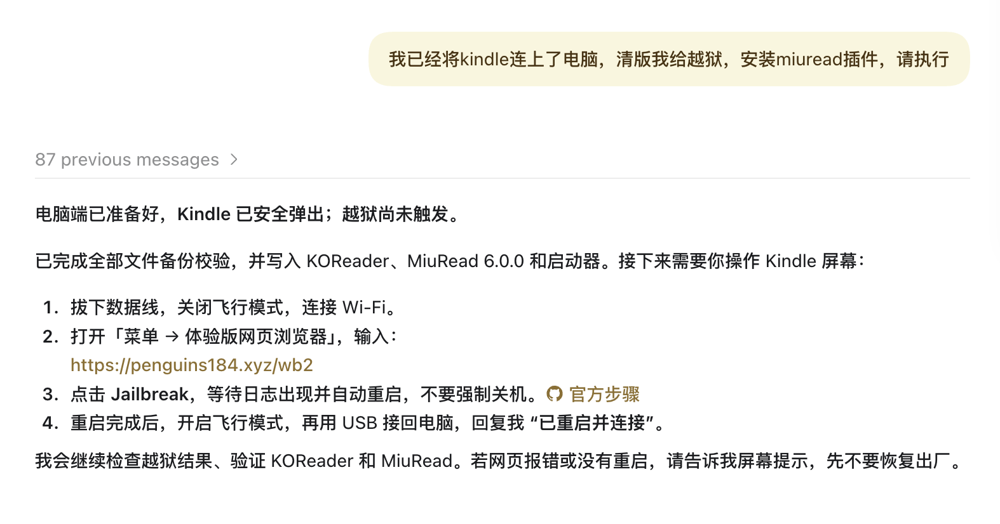

作者：Scond
越狱后感受链接：[十年前的 Kindle，用 AI 装上微信读书后，又成了主力](https://mp.weixin.qq.com/s/FSqtgfr5L3zuYp4RAKO8IQ)

## 步骤清单

- [ ] 准备数据线和 Kindle
- [ ] 查看机型和固件版本
- [ ] 发给 AI，确认是否可以越狱
- [ ] 电脑安装ChatGPT/Codex或者Workbuddy，链接：https://www.workbuddy.cn/events/invite?inviteCode=0fkkwo5f9
- [ ] 连接电脑，让 Codex/Workbuddy等ai准备文件
- [ ] 连接 WiFi，在 Kindle 上触发越狱
- [ ] 重启后重新连接电脑
- [ ] 打开 KOReader 和觅阅桌面
- [ ] 扫码登录微信读书，开始阅读

我的**Kindle Paperwhite 3（第 7 代），固件 5.16.2.1.1** 越狱，安装的是 **KOReader 和觅阅**

你不需要会编程。需要自己完成的主要操作，是**查看设备信息、复制文件、在 Kindle 上点按钮，以及用手机扫码**

**先看清适用范围：本文详细操作针对上面这台设备和版本。其他 Kindle 先完成第一、二部分，确认适用方法后再继续**

## 一、先准备好这些东西

### 1. 一根能传数据的数据线

如果你的电脑支持 Type-C 接口，可以在 **京东搜索“绿联 Type-C 转 Micro-USB 数据线”**。购买时确认：

- 一端是接**电脑的 Type-C**，另一端是接 **Kindle 的 Micro-USB**。
- 商品明确支持 **数据传输**，不能只是充电线。
- **不要买成 Micro-HDMI**

已有能传文件的数据线就不用再买，

**怎么判断买对了：**连接电脑后，能打开 Kindle 的文件夹。只看到充电图标，不代表能够传数据。

### 2. 其他准备

- 建议把 Kindle 充到 **50% 以上**
- 开始前先在 Kindle 的快捷设置里 **开启飞行模式**。**暂时不要升级系统，也不要恢复出厂设置**。

### 3. 先理解这三个名字

| 名称 | 用来做什么 |
| --- | --- |
| **越狱 / WinterBreak2** | 让这台 Kindle 能运行第三方软件；WinterBreak2 是本案例采用的方法 |
| **KOReader** | 安装在 Kindle 上的阅读软件 |
| **觅阅 / MiuRead** | 安装在 KOReader 里面、用于接入微信读书的非官方插件 |

我们最终使用的是觅阅提供的微信读书功能，不是在 Kindle 上安装手机里的微信读书 App。越狱也不等于获得免费会员或免费付费书籍。觅阅需要你授权自己的账号，功能会受微信读书服务和插件兼容性影响。[觅阅项目说明](https://github.com/miumiupy98-art/miuread-koreader)

## 二、确认自己的 Kindle 型号和固件

### 第 1 步：打开“设备信息”

在 Kindle 上操作：

1. 回到 Kindle 原生首页。
2. 点右上角的三个点，再点“设置”；部分界面需要先点“全部设置”。
3. 进入“设备选项”。
4. 点“设备信息”。
5. 记下 **固件版本**，例如 `5.16.2.1.1`，每一段数字都要完整。
6. 记下序列号的 **前 8 位**，用于识别机型。不要把完整序列号、账号邮箱等信息发到群里。

不同版本菜单可能略有差别，找“设备信息 / Device Info”即可。[设备信息位置与越狱查询工具](https://kindlemodding.org/jailbreak-wizard.html)

### 第 2 步：弄清机型代数和固件版本

- “Paperwhite 3 / PW3 / 第 7 代 Paperwhite”说的是机器型号。
- “5.16.2.1.1”说的是目前安装的系统版本。

**完成标志：你能写清“我的 Kindle 是什么机型，当前固件是多少”。**

## 三、把信息和链接发给 AI，确认能否越狱

### 第 3 步：复制下面这段话发给ChatGPT或者Codex，或者腾讯Workbuddy也可以（需要自己在电脑安装）

把方括号替换成自己的信息。型号不知道就写“不确定”。

```text
我想给自己的 Kindle 越狱，并安装 KOReader 和觅阅，用来阅读微信读书。

我的设备信息：
- 型号：[例如 Paperwhite 3 / 第 7 代，或“不确定”]
- 序列号前 8 位：[填写前 8 位，不提供完整序列号]
- 当前固件：[填写完整版本号]
- 电脑：[Windows / Mac]
- 当前已开启飞行模式，尚未升级或恢复出厂。

请联网阅读以下原始资料，结合我的机型和固件判断：
1. 越狱查询：https://kindlemodding.org/jailbreak-wizard.html
2. 越狱总说明：https://kindlemodding.org/jailbreaking/
3. WinterBreak2：https://github.com/KindleModding/Winterbreak2
4. KOReader 安装：https://github.com/koreader/koreader/wiki/Installation-on-Kindle-devices
5. 觅阅：https://github.com/miumiupy98-art/miuread-koreader

请告诉我：
- 我的设备是否支持越狱，然后告诉我要怎么做

我不熟悉编程，请逐步说明每一步在哪操作、成功后应该看到什么。
如果网页打不开或证据不足，请明确说无法确认，不要凭印象猜。
不要让我为了匹配教程先升级、降级或恢复出厂。
```

**如果确认可以越狱，那么继续下一步**

## 四、正式操作：

以下按 **PW3 + 5.16.2.1.1** 来写，顺序是“**电脑准备文件 → Kindle 触发越狱 → 电脑检查结果 → 打开觅阅**”

### 4.1 连接电脑

保持 Kindle 连上电脑，在**电脑上的 Codex** 中发送“**我已经将 Kindle 连上了电脑，请帮我越狱，安装 miuread 插件，请执行**”，并按提示允许它访问 Kindle



### 4.2 连接 WiFi 并触发越狱

等 Codex 确认**已备份、复制好文件并安全弹出**后，再**拔掉数据线，关闭飞行模式，连接 WiFi**，参照它的回复完成以下步骤

1. 回到 Kindle 原生首页。
2. 点右上角三个点，打开“**体验版网页浏览器 / Experimental Browser**”；某些版本的入口在设备选项的高级设置里。
3. 在浏览器地址栏输入 [越狱入口：penguins184.xyz/wb2](https://penguins184.xyz/wb2)。注意是在 **Kindle 浏览器** 中打开，不是在手机或电脑上点击。
4. 等页面加载完成，找到 **Jailbreak** 按钮。
5. 点击一次，等待弹窗和后续操作完成。
6. 过程中可能出现屏幕刷新、安装文字和自动重启。**不要连续重复点击**，也**不要在正在安装时长按电源强制关机**。
7. 等设备回到能够操作的界面后，再开启飞行模式。

### 4.3 重启后重新连接电脑

Kindle 重启后，开启飞行模式，**用数据线重新连接电脑**，再告诉 Codex：“**已重启并连接**”

### 4.4 打开觅阅桌面

ai一顿操作后，完成。便可以点开觅阅桌面了

参考步骤

1. 再次安全弹出 Kindle，然后拔掉数据线。
2. 回到 Kindle 原生“图书馆 / 书库”，清除只显示某一类书籍的筛选，查看本机已下载内容。
3. 找到 **KOReader Stop Framework**，点击打开。
4. 等待进入 KOReader。
5. 如果出现觅阅模式选择，选择“**恢复觅阅桌面**”，并按提示重启 KOReader；如果已经进入觅阅桌面，就不用重复恢复。
6. 若没有弹出选择框，点击 KOReader 顶部区域打开菜单，在“工具”页查找觅阅入口，再进入“觅阅设置 → 运行与兼容 → 运行模式”，选择觅阅桌面并按提示重启。找不到觅阅入口时，先检查上一步的插件文件位置。


这里的“**恢复觅阅桌面**”是切换插件的显示模式，**不是恢复出厂设置**。我们操作时选择后已正常进入。

### 4.5 登录微信读书

**KOReader 和 MiuRead 能正常启动后。** 接下来完成微信读书登录：

1. 关闭飞行模式，连接 Wi-Fi。
2. 在觅阅中点击 **「未登录 · 点击扫码」或「扫码登录」**，用手机微信扫描并确认授权。
3. 成功后，便可以开始阅读了

**过程中如果遇到不清楚的，直接问AI就行了，或者联系作者：微信公众号Scond，主页scond.me**
