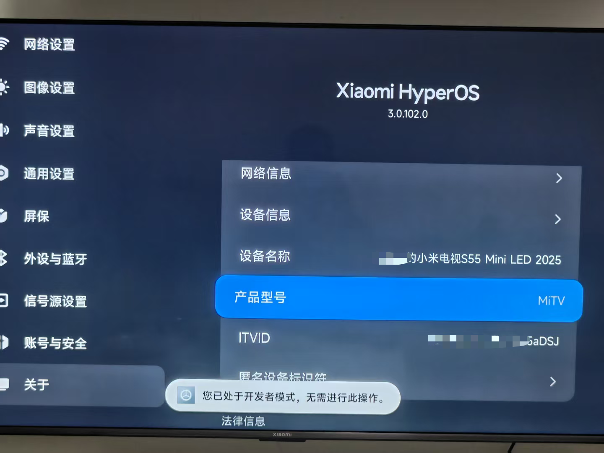
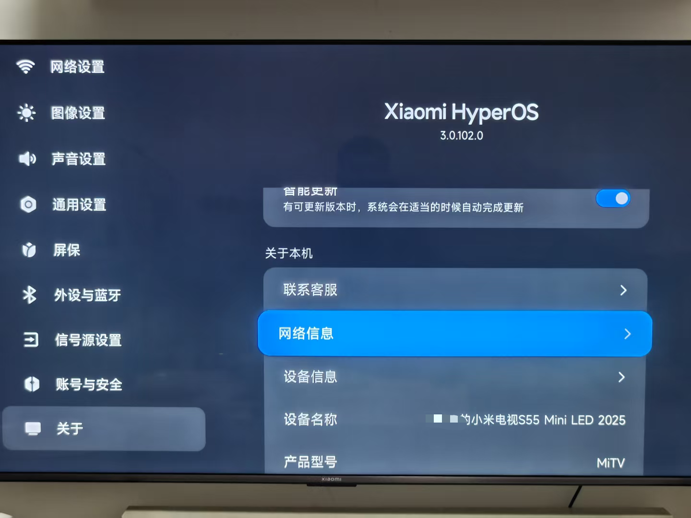
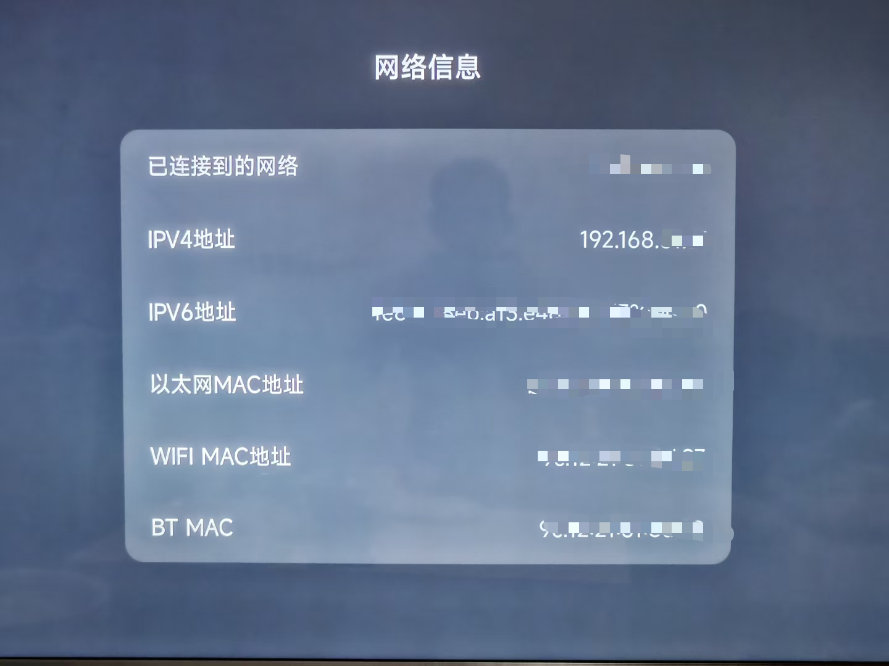

作者公众号：Scond · 更新：2026-10-31

## 步骤清单

**先准备、确认机型**

- [ ] 电脑安装 WorkBuddy 或 Codex，workbuddy官方下载链接：https://www.workbuddy.cn/events/invite?inviteCode=0fkkwo5f9
- [ ] 查看文末机型清单，或把型号和系统版本发给 AI，确认是否支持

**确认机型支持后，再继续**

- [ ] 准备电视和遥控器，电脑与电视连上同一个网络
- [ ] 开启开发者模式和 ADB 调试
- [ ] 记下电视的 IPv4 地址
- [ ] 让电脑上的 AI 安装，在电视上确认授权
- [ ] 检查主页键、待机唤醒和重启后的效果


## 一、准备电脑上的 AI 工具

已有 WorkBuddy 或 Codex 就直接用；还没安装，可以从[腾讯官方页面下载 WorkBuddy 电脑版](https://cloud.tencent.com/act/pro/workbuddy)，选择对应的 Windows 或 Mac 安装包

查询机型支持情况可以用能联网的 AI；**实际安装要用能执行电脑命令的工具，普通聊天窗口不能代为安装**

你不用会编程，电视上按遥控器，电脑上的命令交给 AI

## 二、确认自己的机型是否支持

**文末有当前支持的清单，请以实际确认为准**

本文以我的 **小米电视 S55 Mini LED 2025** 为例，配图系统是 **Xiaomi HyperOS 3.0.102.0**，安装使用的是 Mac 上的 Codex

其他型号先核对兼容性，菜单路径以自己的电视为准。可在“设置 → 关于 / 设备信息”中查看型号和系统版本，填入下面这段话发给 AI；不知道的写“不确定”

```text
我的电视是：[品牌＋完整型号]
系统版本：[填写版本，可附设备信息照片]

请联网查看 https://github.com/pengchujin/aerial-tv ，确认这台电视能否安装 Aerial、接管主页键和开机，有哪些限制
能用的话，请告诉我在哪里打开 ADB 调试、查看 IP 地址
请附依据链接，不确定就明确说明，先不要执行安装
```

**确认支持后再继续；不支持或无法确认时，先不要安装**

## 三、在电视上开启调试

先让电脑和电视连上家里同一个 Wi-Fi；电视插网线也可以，但要接同一台路由器

下面以小米电视为例，其他型号按前一步核实的菜单路径操作

### 开启开发者模式

1. 打开电视“设置”（齿轮图标）→“关于”
2. 选中“产品型号”，连续按遥控器确认键，直到提示已进入开发者模式

图中提示“您已处于开发者模式”，表示这一步已完成



### 打开 ADB 调试

ADB 调试就是允许电脑连接电视，帮它安装和设置软件

返回“账号与安全”，打开 **“ADB 调试”**；如果有“安装未知来源的应用”，也按安装需要开启

确认 ADB 显示为开启。找不到入口时，把型号和设置页照片发给 AI 核对

## 四、记下电视的 IP 地址

1. 进入 **设置 → 关于 → 网络信息**，按遥控器确认键



2. 找到 **“IPv4 地址”**，记下完整的四组数字和中间的点，例如 `192.168.1.123`



**填自己电视上的 IPv4，不要照抄示例，也不要填成 IPv6 或 MAC 地址**。图中地址已打码；如果你的电视没有显示 IPv4，先确认已经联网

## 五、让 AI 安装

### 复制安装要求

在电脑上的 WorkBuddy 或 Codex 新建对话或任务，替换方括号里的信息后发送

```text
请在我的电脑上实际执行，为电视安装 Aerial，并配置主页键和开机进入 Aerial

电视品牌和型号：[填写型号]
系统版本：[填写版本]
电视 IPv4：[填写地址]
电脑系统：[Windows 或 Mac]
电脑和电视已连接同一网络，电视已打开 ADB 调试

请先核对机型，再按项目说明安装：
https://github.com/pengchujin/aerial-tv
https://aerial.qust.me/agent.md
打不开时使用：
https://raw.githubusercontent.com/pengchujin/aerial-tv/main/site/agent.md

只从官方来源下载，不卸载或停用原桌面，不恢复出厂设置
先保存将修改的设置，解释所需权限，等我确认后再授权；不要默认保持 ADB 永久常开
需要我操作时，一次告诉我一步；重启前先告诉我，不支持或无法确认时先停下
完成后核对安装版本和主页键接管结果，再指导我检查待机唤醒和重启
```

工具请求联网、下载或执行命令时，确认是在做这次安装后再允许。若要求选择工作文件夹，新建一个空的“Aerial安装”文件夹即可

### 在电视上确认授权

首次连接可能弹出 **“允许 USB 调试吗？”**，用 Wi-Fi 连接也可能显示这个名字

1. 用遥控器选“允许”，按确认键
2. 如果是自己的电脑，可以勾选“始终允许这台计算机”
3. 告诉 AI：“电视上已允许，请继续”

无障碍、通知使用权等权限，让 AI 先解释用途，再确认授权。安装期间电脑与电视保持联网

## 六、检查结果，设置桌面

按主页键，确认进入 Aerial 的应用图标桌面，再检查待机唤醒和正常重启后的表现；若回到原桌面，把现象告诉 AI 继续检查

- **找全部应用**：首页向下按
- **整理图标**：选中应用，长按确认键，按菜单提示整理
- **开机直达应用**：选中应用，长按确认键，设置“开机时打开”，再测试唤醒效果
- **换壁纸和屏保**：第一排应用处向上，进入右上角控制中心，查找“个性化”等设置

菜单以实际版本为准，更多功能见[项目说明](https://github.com/pengchujin/aerial-tv#功能)

## 遇到问题怎么办

| 情况 | 先检查 |
| --- | --- |
| AI 只给步骤，没有执行 | 是否使用能执行本机命令的电脑版工具；告诉它“请在我的电脑上实际执行” |
| 连接失败、Connection refused 或超时 | 电视是否开机、ADB 是否开启、IP 是否正确、是否连接同一网络 |
| 提示 unauthorized | 在电视调试弹窗中选“允许”，再让 AI 重试 |
| 能打开 Aerial，主页键却回到原桌面 | 告诉 AI“已安装，但主页键没有接管”，检查权限与机型限制 |

其他报错直接复制给 AI，并说明停在哪一步

### 想恢复原桌面

电脑与电视保持联网，把下面这段话发给 AI，替换成自己的 IP 地址

```text
请按 https://aerial.qust.me/agent.md 的还原说明，将电视 [IPv4 地址] 恢复为原桌面，撤销这次接管设置，Aerial 先不卸载
连不上时，先指导我重新打开 ADB 调试；完成后检查，并让我按主页键确认
```

## 补充：申请关闭小米电视开机广告

**Aerial 不会去掉开机广告或视频应用内的广告**

打开 **设置 → 关于 → 联系客服**，按电视显示的官方渠道联系人工客服，说明：

> 我想申请关闭这台小米电视的开机广告，请问是否支持，需要提供哪些设备信息？

需要 MAC 地址时，在前面的“网络信息”页查看；有多个地址就问清需要哪一个，只通过官方客服提供

一般1-2个工作日就可以了

## 附录：当前机型支持情况

**实际以项目更新为准，当前核对日期：2026年10月31日**

按[项目机型清单](https://github.com/pengchujin/aerial-tv#支持的机型)整理，主要来自用户反馈，并非逐台实测。请同时核对型号、系统和限制；未列出不代表不支持

✅ 已有可用反馈　⚠️ 可用但有限制　❌ 暂时无法正常使用或接管桌面

即使标为 ✅，也请看限制说明，不能只按品牌判断

### 小米 / Redmi / 峰米

| 型号 | Android | 支持情况与主要限制 |
| --- | --- | --- |
| 小米 / Redmi：MiTV-MFTR0（Redmi X65 2026）、MFFU0、MTSU0（S65 Mini LED 2026 至尊版） | 14 | ✅ 有日常使用反馈（[记录](https://github.com/pengchujin/aerial-tv/blob/main/docs/devices/xiaomi-mitv-mftr0.md)） |
| 小米：MiTV-ASTP0、ASTP1、NSOP0、MFTP0 | 9 | ✅ MFTP0 被清理后，可能需等 30–60 秒恢复（[记录](https://github.com/pengchujin/aerial-tv/blob/main/docs/devices/xiaomi-mitv-mftp0.md)） |
| 小米：小米电视 4 / 4A / 4X / 3S、小米盒子 4 | 6 | ✅ 需 Aerial 1.43 起；按主页键后可能等待几秒（[记录](https://github.com/pengchujin/aerial-tv/blob/main/docs/devices/xiaomi-android6.md)） |
| 小米：小米电视 2（MiTV2-49） | 4.3 | ❌ Lite 能运行，但不能接管主页键（[记录](https://github.com/pengchujin/aerial-tv/issues/770)） |
| 小米（峰米）：Ultraman 系列投影仪 | 9 | ✅ 有可用反馈（[记录](https://github.com/pengchujin/aerial-tv/blob/main/docs/devices/xiaomi-ultraman-projector.md)） |

### TCL / 雷鸟

| 型号 | Android | 支持情况与主要限制 |
| --- | --- | --- |
| TCL：MT5879 国行、98T8H | 11 | ✅ 有日常使用反馈（[记录](https://github.com/pengchujin/aerial-tv/blob/main/docs/devices/tcl-mt5879-cn.md)） |
| TCL：Q9L Pro | 14 | ⚠️ 需 USB 线连接并允许自启；切换信号源可能无画面（[记录](https://github.com/pengchujin/aerial-tv/issues/792)） |
| 雷鸟：75S78A Plus（FFALCON T966D5） | 14 | ❌ 主页键接管失败；另有开机进入的配置方法（[记录](https://github.com/pengchujin/aerial-tv/blob/main/docs/devices/ffalcon-t966d5.md)） |
| TCL：75V2（m7221） | 8 | ✅ 有开机直达反馈（[记录](https://github.com/pengchujin/aerial-tv/blob/main/docs/devices/tcl-m7221-cn.md)） |
| TCL / 雷鸟：60A730U、55V2 Pro（x32a0）、65Q10E 与鹤 6（m7642）、75S365C、75Q10L | 5.1–14 | ✅ 部分型号需特殊安装版本或额外配置（[记录](https://github.com/pengchujin/aerial-tv/issues/620)） |
| 雷鸟：55S595C Ultra、鹤 6 2025 Ultra | 11+ | ❌ 能安装，但不能接管主页键（[记录](https://github.com/pengchujin/aerial-tv/blob/main/docs/devices/tcl-mt9655-cn.md)） |

### 索尼

| 型号 | Android | 支持情况与主要限制 |
| --- | --- | --- |
| A80J 国行、BRAVIA VH1 | 10 / 12 | ✅ 有可用反馈 |
| KD55X7000D 国行 | 8 | ✅ 调亮度仍需进入电视原设置（[记录](https://github.com/pengchujin/aerial-tv/issues/757)） |

### 创维 / 酷开

| 型号 | Android | 支持情况与主要限制 |
| --- | --- | --- |
| 创维 / 酷开：K3 Pro、75A7D | 11 | ✅ 75A7D 需 1.45 起支持信号源；开机可能先显示原桌面（[记录](https://github.com/pengchujin/aerial-tv/issues/894)） |
| 创维 / 酷开：65G60、8R134 / 8R145、aigc 系（C10 投影、P60、7T863） | 8–11 | ⚠️ 开机可能先到原桌面，被清理后可能等 20–30 秒恢复（[记录](https://github.com/pengchujin/aerial-tv/blob/main/docs/devices/skyworth-coocaa.md)） |
| 创维 / 酷开：5S21（50K2、7626K2）、5S05（60U2）、8H66 H7 | 5.x | ⚠️ 主页键不能返回 Aerial，且无法列出信号源 |
| 创维 / 酷开：8H83 M6（Hi3751V500） | 4.4 | ❌ Lite 可运行，但不能接管主页键和开机（[记录](https://github.com/pengchujin/aerial-tv/issues/903)） |
| 创维 / 酷开：8H57_H5 | 5.1 | ⚠️ 开机可能要等十几秒（[记录](https://github.com/pengchujin/aerial-tv/issues/785)） |
| 创维：1AA46_D4（T963） | 9 | ✅ 有可用反馈（[记录](https://github.com/pengchujin/aerial-tv/issues/796)） |
| 创维：7T641、7T634_P3H、75A6E、55A5F Pro（8R702）、8R721_A6FP | 13 | ❌ 有黑屏或应用被系统结束的反馈（[记录](https://github.com/pengchujin/aerial-tv/issues/864)） |
| 创维：小湃 P3（Q5001 / cupid-p2）盒子 | 10 | ⚠️ 需改包名接管主页键；开机启动受阻（[记录](https://github.com/pengchujin/aerial-tv/blob/main/docs/devices/skyworth-p3-box.md)） |

### 海信 / Vidda

| 型号 | Android | 支持情况与主要限制 |
| --- | --- | --- |
| 海信 / Vidda：VIDAA 系列（汇总反馈） | 5–14 | ⚠️ 多数开机仍到原桌面；C1 投影无法接管，需逐型号核对（[记录](https://github.com/pengchujin/aerial-tv/blob/main/docs/devices/hisense-vidaa.md)） |
| 海信：65E52D | 8 | ✅ 有开机直达反馈（[记录](https://github.com/pengchujin/aerial-tv/issues/672)） |
| 海信：75E3F（VIDAA_TV，n62016） | 9 | ✅ 有开机直达反馈（[记录](https://github.com/pengchujin/aerial-tv/issues/847)） |
| 海信：E5Q Pro | 11 | ✅ 有可用反馈（[记录](https://github.com/pengchujin/aerial-tv/issues/790)） |
| 海信：85U7G-PRO（MT9652） | 9 | ✅ 可用系统默认桌面选项设置，无需 ADB（[记录](https://github.com/pengchujin/aerial-tv/issues/886)） |
| 海信：VIDAA_TV（MSD6A348） | 4.4 | ✅ 使用 Lite；无法调亮度（[记录](https://github.com/pengchujin/aerial-tv/issues/769)） |
| 海信：LED47K600X3D（VIDAA_TV，MT5880） | 4.0.4 | ⚠️ Lite 能开机进入，但主页等遥控器按键无法接管（[记录](https://github.com/pengchujin/aerial-tv/issues/913)） |

### 其他品牌与设备

| 型号 | Android | 支持情况与主要限制 |
| --- | --- | --- |
| 华为：M330 盒子 | 4.4 | ❌ Lite 能安装，但开机会被改回原桌面（[记录](https://github.com/pengchujin/aerial-tv/issues/850)） |
| 松下：TH-55HX560C（创维代工） | 8 | ⚠️ 无法列出信号源 |
| 康佳：KKTV U86V9、2861 | 9 | ✅ U86V9 无法在 Aerial 内调亮度（[记录](https://github.com/pengchujin/aerial-tv/blob/main/docs/devices/konka-kktv-u86v9.md)） |
| 乐视：超4 X55（f608） | 6 | ✅ 有安装、自启和主页键接管成功反馈（[记录](https://github.com/pengchujin/aerial-tv/issues/510)） |
| 乐视：超3 X65（X65-168CQ） | 5.0.1 | ⚠️ 按主页键时可能被系统结束，接管不稳定（[记录](https://github.com/pengchujin/aerial-tv/blob/main/docs/devices/letv-x3-65.md)） |
| 夏普：LCD-50SU671A | 6 | ✅ 打开 ADB 需要额外工具 |
| OPPO：K9 | 9 | ⚠️ 安装需要修改包名（[记录](https://github.com/pengchujin/aerial-tv/blob/main/docs/devices/oppo-coloros-tv.md)） |
| 极米：Z7X、m7642 | 9 | ✅ Z7X 打开 ADB 需要额外工具（[记录](https://github.com/pengchujin/aerial-tv/blob/main/docs/devices/xgimi-z7x.md)） |
| 极米：神灯 L1（m7642，pig_chivalrous） | 9 | ✅ 默认桌面设置可能在开机后丢失，需额外配置（[记录](https://github.com/pengchujin/aerial-tv/blob/main/docs/devices/xgimi-z7x.md)） |
| 极米：Z6X 第四代（XK03U / ironman / m7221） | 8 | ⚠️ 已测试 HDMI1 列表与切换，视频输出尚未测试（[记录](https://github.com/pengchujin/aerial-tv/blob/main/docs/devices/xgimi-xk03u-android8.md)） |
| 极米：H3、m7221 | 8 | ✅ 打开 ADB 需要额外工具（[记录](https://github.com/pengchujin/aerial-tv/blob/main/docs/devices/xgimi-h3.md)） |
| 大眼橙：X7、X7D 投影仪 | 9 / 5.1 | ✅ 有可用反馈，具体 HDMI 行为见记录（[记录](https://github.com/pengchujin/aerial-tv/blob/main/docs/devices/obe-x7.md)） |
| 大眼橙：OBE_R3Ultra 高亮版（投影仪，MT5879） | 11 | ✅ 主页键切换可能等待约 13 秒（[记录](https://github.com/pengchujin/aerial-tv/blob/main/docs/devices/obe-r3-ultra.md)） |
| 腾讯极光盒子：6 / 6SE / 7S | 10 / 14 | ✅ 6 有正常反馈；⚠️ 7S 开机仍停在原桌面（[记录](https://github.com/pengchujin/aerial-tv/blob/main/docs/devices/tencent-aurora-box.md)） |
| 当贝：盒子 Max1、H5，哈趣 K2（当贝 OS） | 9 | ✅ 有可用反馈 |
| 当贝：H3S 盒子（RK3566） | 11 | ⚠️ 按主页键后可能等 7–12 秒恢复（[记录](https://github.com/pengchujin/aerial-tv/issues/849)） |
| 当贝：F3 投影仪 | 6 | ❌ 不能设置第三方桌面，也缺少无障碍服务（[记录](https://github.com/pengchujin/aerial-tv/issues/789)） |
| 坚果：S621 | 13 | ❌ 无法开启所需无障碍设置，主页键接管失败（[记录](https://github.com/pengchujin/aerial-tv/issues/793)） |
| 爱普生：DTP9733 投影仪 | 11 | ✅ 有可用反馈 |
| 志影 / 喜瑞：HS350 投影仪（海思，YunOS） | 9 | ⚠️ 按主页键后可能等 10–30 秒；部分安装方式需补授权（[记录](https://github.com/pengchujin/aerial-tv/issues/853)） |
| 其他盒子：CM311-1（改版 ATV）、PPTV K55U27、HK1 Box（S905X3） | 9 | ✅ 有可用反馈，HK1 Box 可直接设为默认桌面（[记录](https://github.com/pengchujin/aerial-tv/issues/838)） |
| 斐讯：T1 盒子（S912） | 7.1.2 | ✅ 全部应用页可能卡顿，可尝试“流畅”效果（[记录](https://github.com/pengchujin/aerial-tv/issues/876)） |

### 系统限制

- Android 5.0 及以上使用完整版；Android 4.0–4.4 使用 Aerial Lite 测试版，功能不同
- 不支持 LG webOS、三星 Tizen、华为鸿蒙智慧屏和 Android 4.0 以前的系统
- 部分老乐视、荣耀智慧屏、老康佳无法开启 ADB，需先核对型号

---

**关于我**  


欢迎关注公众号：Scond


