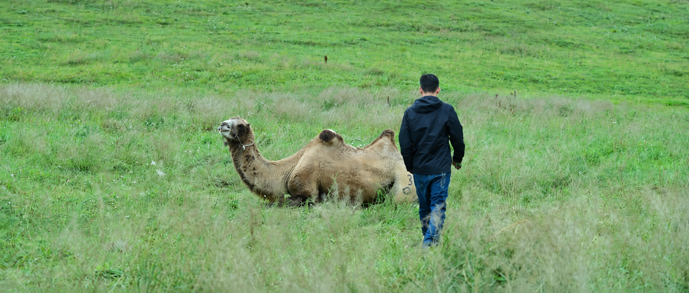
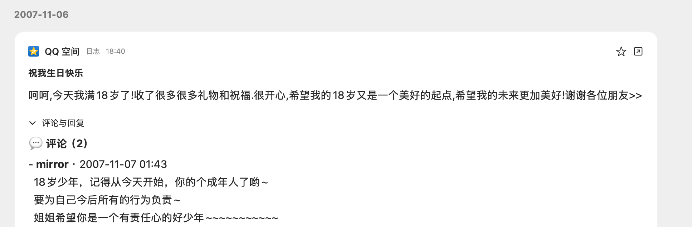
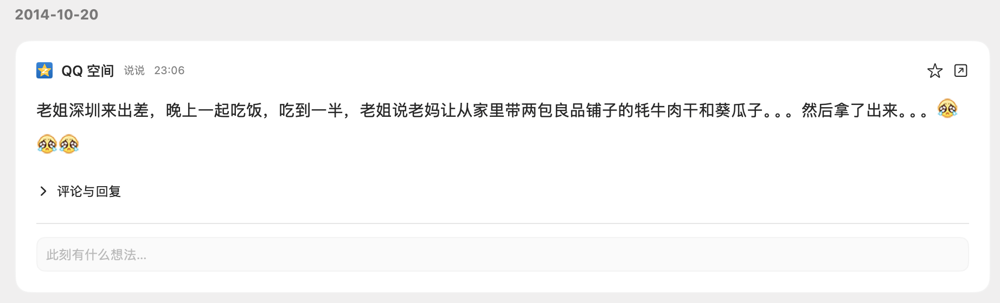
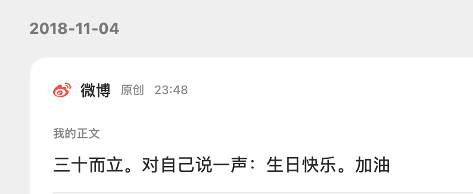

23年生日的时候，那天很不开心。我躺在床上，久久没有睡着，回忆过往这些年生日是怎么过的。但脑袋里一片空白。那一天，我决定每年这个时候，都要记录当下的感受

不久前，我把尘封已久的QQ空间、被封的微博，以及社交媒体的内容用AI抓取到了本地备份

晚上，用AI整理了从2007年到2026年，近20年里和生日有关的电子记忆，保存下来，是124KB

读完之后，五味杂陈......很多2023年怎么都想不起来的回忆，又模模糊糊的浮现在眼前

第一条记忆，来自2007 年 11 月 6 日，我写在QQ空间的日志，标题是“祝我生日快乐”——

> 呵呵,今天我满18岁了!收了很多很多礼物和祝福.很开心,希望我的18岁又是一个美好的起点,希望我的未来更加美好!谢谢各位朋友>>

那时候的“呵呵”还不是暗示骂人的，日志的内容看起来稚嫩。我姐姐在下面评论：

> “18岁少年，记得从今天开始，你是个成年人了哟~
> 
> 要为自己今后所有的行为负责~
> 
> 姐姐希望你是一个有责任心的好少年~~~~~~~~~~~“”

2009 年 11 月 13 日，在QQ空间日志，我写道：

> “这是从小第一次在外生日，
> 
> 也是第一次到二十岁（貌似这个也只有一次啊）！
> 
> 爸妈还有金姨今天来看我了…全家一起吃饭，提前庆生，独在异地…我也不孤独啊！
> 
> 昨天，跟大学的兄弟们提前过生日，喝了不少酒…甚是开心…
> 
> 恩！二十了…一个崭新的数字…多么有意义！
> 
> 要成长，更要成熟”

晚上，我又发了一条说说：

> “告别十几岁的阶段…我毅然的奔向了二十，哦、年轻真好！十几岁真好！”
> 
 朋友在下面留言调侃“那我得好好珍惜我仅有的两个月的十几岁的生活了。”

2011年，和一个好友聊天之后，我留下的文字是：

> 朋友说我是为数不多从小玩到大的朋友，有十多年了......那天晚上我有点睡不着了。我在想，我从小到大一起玩过的人有多少，而一直做了朋友的又有多少？好像真的很少吧...

2014年，那时候刚毕业没多久，姐姐刚好来深圳出差。吃饭吃到一半，她掏出我妈让她带过来的零食...当时留下了三个流泪的表情，12年过去了...再次翻到....

2016年，第一次在国外生日，在伊斯坦布尔，2017年，是在巴塞罗那

2018年，终于选择了结束海外的漂泊。那一年11月4日，我30岁。在微博发了一条“三十而立。对自己说一声：生日快乐。加油”

2019年，出差在成都。晚上我从成都回到武汉，走出机场，感觉真冷，走进家里，一桌菜，一家人都在等我，小外甥帮我点上生日蛋糕的蜡烛，给我唱生日歌。那是我最近这么多年里，最开心的一次生日

2023年，不怎么开心

2024年，下班后，我跑了10km回家。那天和一个发小聊了很久，后来我们放下戒备，聊了一些彼此的现状以及困境

我们觉得，从传统意义上来说，在某些方面我们都是失败的。但我们得到的结论是，人的一生都是在解题，有些题目也并非必答题，比如婚姻、生孩子、事业，是可以选择跳过的，只要坦然接受随之而来的后果。

那天，我摘抄了《纳瓦尔宝典》里关于健康的一段话，也觉得身心健康，比什么都重要

2025年，生日当天，我定了早晨6点50的闹钟，起床沿着河边，跑了15km，做完40个俯卧撑，我写道：

> “耳机里随机的音乐有喜欢的，也有不喜欢的。喜欢的，就用心听，不喜欢的就多关注河边的景色。人生也像一串歌单，开心和痛苦的时刻，在时间的维度上，每一秒都是等宽的
> 
> 上周上班的时候，突然拿起笔记本，按顺序把出生至今的每一年写在上面，小学-初中-高中-工作，三十多年，也不过一串数字，连一张纸都无法填满，好多记忆都已斑驳，人生真是短”

整理到此处，已是深夜，周围很安静，只有手指敲打键盘的声音。而马上，凌晨过后，又要年长一岁了。想对自己说点什么，又没想好

2007年，我在QQ空间写下“祝我生日快乐”

2026年，那就再对自己说一次祝我生日快乐吧

\*原文链接：[祝我生日快乐](https://mp.weixin.qq.com/s/KFOsf1IUzS1jKfjOCe8-Wg)
{: .post-source }

---

**关于我**  

