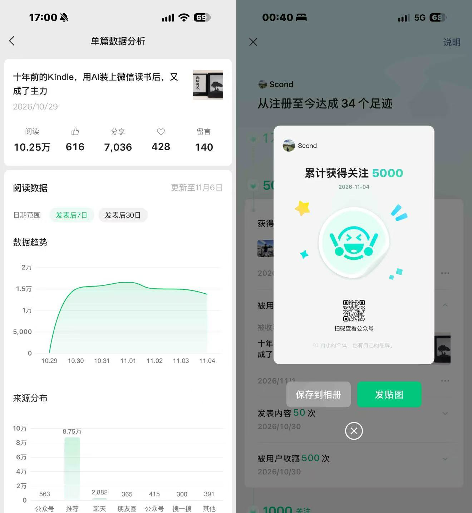
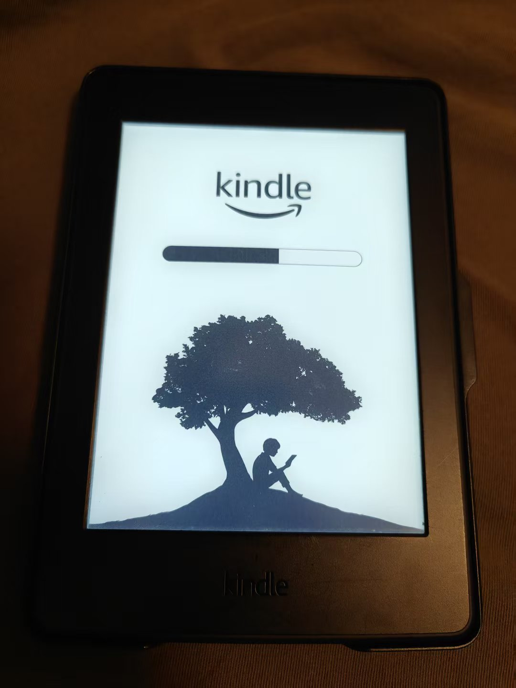
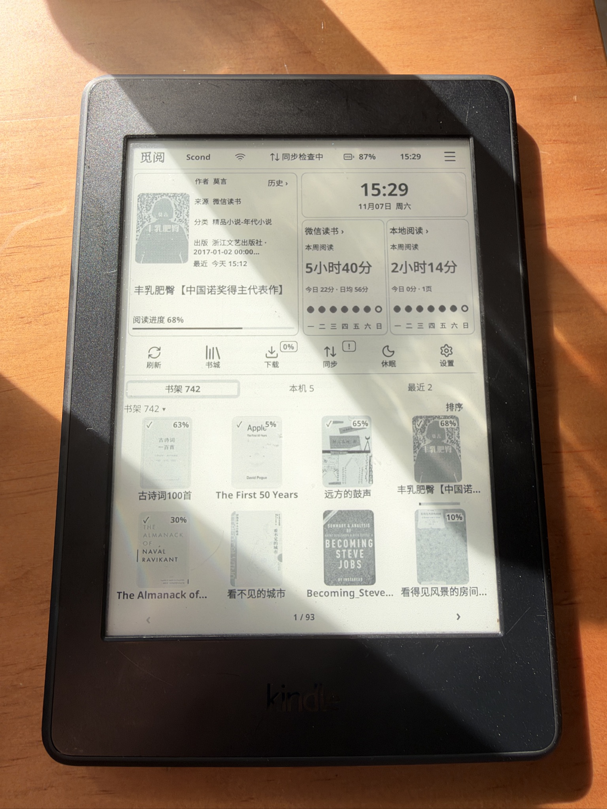
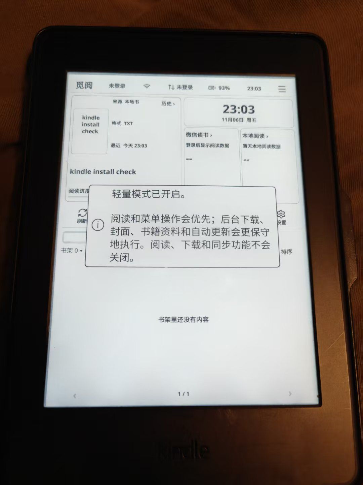
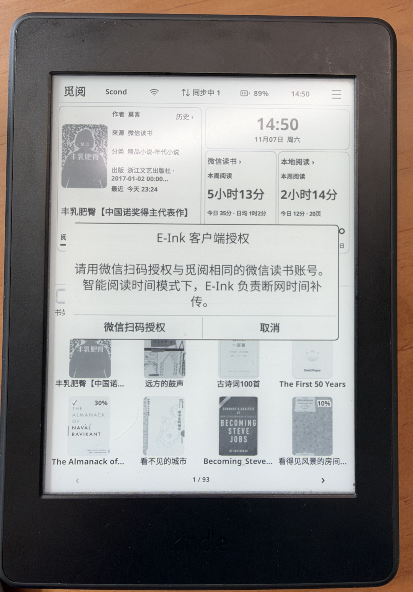
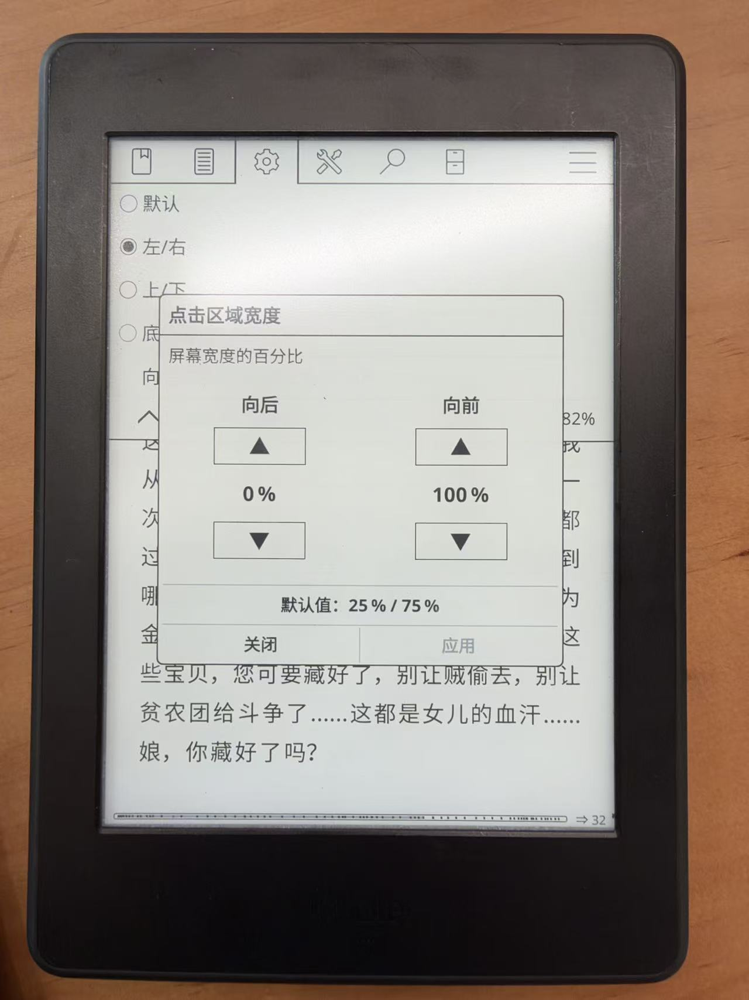
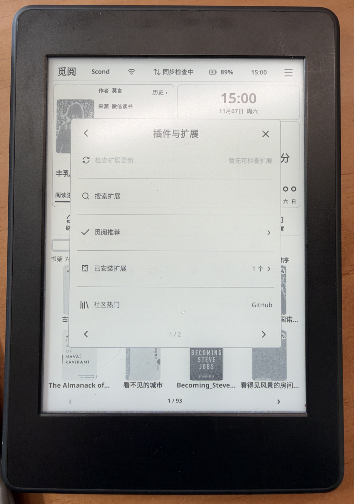
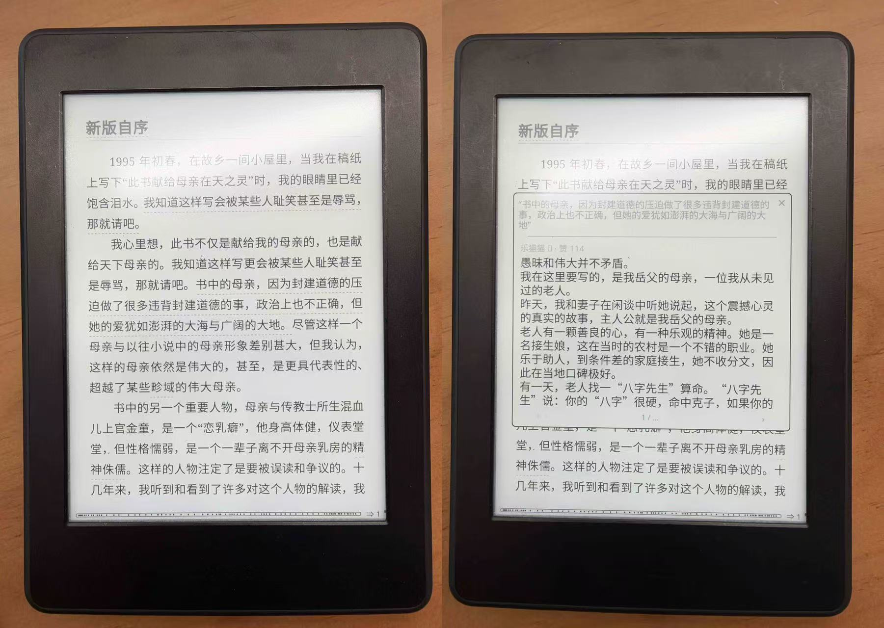
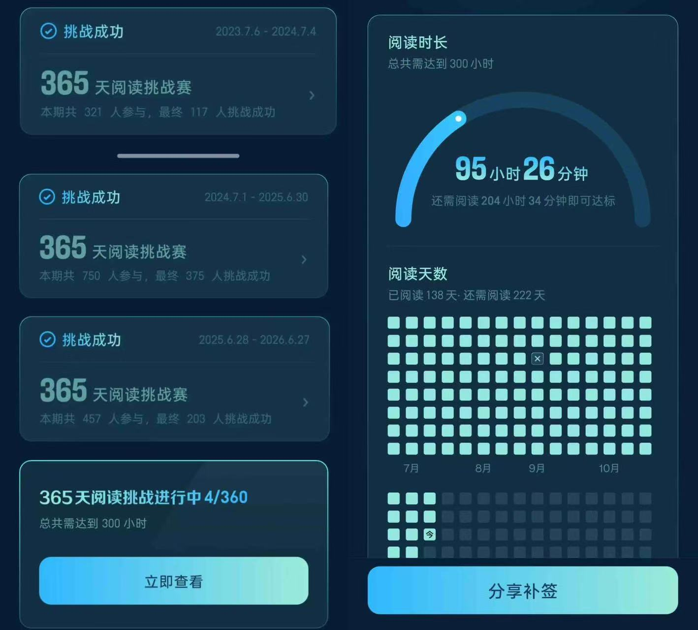

上周分享Kindle越狱教程和攻略后，帮助了近300多个人完成了越狱，公众号收获了**4000多位关注**，也是我的第一篇10W+，同时收到了大量的感谢，还是挺吃惊的，谢谢大家

也收到了很多咨询，比如越狱后是否还可以看原来Kindle里面的书，微信读书是否会同步进度，是否影响阅读挑战打卡，如何安装精美的锁屏插件……

重度使用一周之后，今天来回答大家关心的10个问题，分享一些使用技巧

准备安装的朋友，可以先看第一部分。已经装好的朋友，可以直接看后面的使用体验和设置技巧

{: width="413" }

11月4日，公众号累计获得关注达到5000

*以下以我的Paperwhite 3为例，不同版本的菜单名称可能有所不同

## 一、准备安装前，先弄清这3件事

### 1. 我的设备支持越狱吗？

大家的设备太多，版本不一样，无法一一确认，但是90%的设备都是可以的

教程第一步已经提供了判断方法，先确认自己的设备型号和系统版本，根据教程判断即可

### 2. 越狱难吗？

通过教程完成越狱的伙伴里，很多人之前完全没有用过AI

只要参考教程，对着步骤操作，遇到了问题，拍照发给AI，基本都可以解决的

还没有看过教程的朋友，可以在公众号后台回复「Kindle」或「越狱」获取

{: width="480" }

群友完成越狱后的反馈

### 3. 越狱后，微信读书要充值会员吗？

越狱只是可以让你的Kindle更加流畅地使用微信读书，书籍是否可以阅读，和你的微信读书APP的状态一致

**越狱不会把付费书变成免费书**，原本需要会员或单独购买的书，仍然需要。越狱≠破解

## 二、装好以后，大家最关心的使用问题

### 4. 越狱后，还能看原来Kindle里面的书吗？

可以，原来的书仍然可以回到Kindle原生系统里看

需要切回原生系统时，可以重启设备：长按电源键，重启后就会进入Kindle原生系统

如果要再次进入微信读书插件，点击Kindle书架中的「KOReader stop framework」，启动KOReader，再进入觅阅即可

这里是回到原来的阅读界面，不需要恢复出厂设置或重新越狱

{: width="360" }

重启时的Kindle画面，等待启动完成后回到原生系统

### 5. 越狱后续航怎么样？

上周六充满电100%，使用Kindle联网看书**2小时14分钟**，偶尔还开了背光，待机6天，电量剩余**60%**

我觉得这个续航还是很强的，不输国产墨水屏

{: width="480" }

右侧「本地阅读」显示本周阅读2小时14分钟；拍照前又补充了一会儿电，所以图中显示87%

### 6. 越狱后，是否卡顿？

我的设备是Paperwhite 3，已经10年了，每天睡前使用，基本不卡顿

如果设备比较卡，可以先检查这几项：

- **开启轻量模式**：设置 → 运行与兼容 → 性能与兼容性 → 轻量模式
- **检查插件**：是否安装了太多插件，卸载不必要的插件
- **检查存储空间**：如果剩余空间已经很少，可以先备份，再清理不需要的书籍文件

{: width="480" }

轻量模式开启后的提示：优先处理阅读和菜单操作，阅读、下载和同步功能不会关闭

### 7. 读书记录会同步微信读书吗，会影响阅读挑战打卡吗？

我查询了资料，也进行了实测，进度和阅读时长的同步方式如下：

- 连接wifi：可以自动同步进度
- 离线阅读：可以通过E-Ink功能在本地保存阅读时长，有网络之后再补传

设置路径：
**设置 → 同步与下载 → 同步 → 阅读时长同步 → E-Ink客户端授权设置**

点击「微信扫码授权」，授权与觅阅相同的微信读书账号

图中提示，智能阅读时间模式下，E-Ink负责断网时间补传。设置好后，可以回到手机微信读书核对阅读时长和挑战打卡状态。不过，我为了双保险，还是会每天去微信读书APP检查一次，把这个功能当做保底方案

{: width="480" }

E-Ink客户端授权入口：点击「微信扫码授权」

## 三、让Kindle用得更顺手

### 8. 设置左右两边点击，都能翻到下一页

这个功能对于我来说太重要了，有时候左手拿着Kindle，点击左边区域也想实现翻到下一页

按下面的路径打开设置：

**打开任意一本书 → 顶部下拉 → 右下角的KOReader → 顶部齿轮⚙️按钮 → 手势 → 翻页 → 选择「左/右」**

然后修改两个参数：

- 向后（上一页）：**0%**
- 向前（下一页）：**100%**

设置好后点击「应用」，点击左边也可以翻到下一页了

如果想返回上一页，在阅读页面向右滑动即可

{: width="480" }

「点击区域宽度」设置：向后0%，向前100%，设置后点击「应用」

### 9. 如何安装插件

打开：**设置 → 插件与扩展 → 觅阅推荐**

选择自己喜欢的插件，按对应插件的说明完成安装和启用

建议不要装太多，毕竟都是老古董了

推荐安装「墨痕 inkstain」，在锁屏页面就可以看到每天的阅读时长、读过的书，很有成就感

装好后，可以锁屏看看是否已经显示阅读统计；如果仍是原来的锁屏页面，再检查插件的启用和锁屏设置

如果你已经按前篇教程在电脑上安装并使用WorkBuddy，也可以继续发送指令「我想安装插件」，让AI帮你完成

{: width="480" }

在「插件与扩展」中点击「觅阅推荐」，查看可选插件

### 10. 如何查看别人的想法和评论？

在觅阅书架中，**长按书籍 → 更多操作 → 下载正文与公开想法**

这里下载的是包含公开想法的正文，下载完成后，打开对应的版本阅读

{: width="640" }

左：带有划线标记的正文；右：打开后显示的公开想法

---

最后，我从2023年开始参加365天微信读书挑战，今年已经是第4年了，目前是第138天，所以特别在意阅读时长同步和挑战打卡是否正常

左边是前三次365天阅读挑战的完成记录；右边是最新的挑战进度

我建了一个微信读书分享群，互相交流、分享读书

如果你也想参加，可以在公众号后台回复「读书群」加入，一起读书

也欢迎大家在评论分享越狱后好用的插件、使用技巧、好看的壁纸……

*还未越狱的，关注公众号，回复“越狱”，免费获得教程+加入互助群

\*原文链接：[Kindle 装上微信读书后，10个常见问题和使用技巧](https://mp.weixin.qq.com/s/tGTho0tyzSF3EiFdWA56Gw)
{: .post-source }

---

**关于我**  
旅行、跑步、看书，也喜欢 AI 和数码

🌍 30+ 国家 · 🏅 半马 1h36 ｜ 全马 3h58

[主页 scond.me](https://scond.me)

