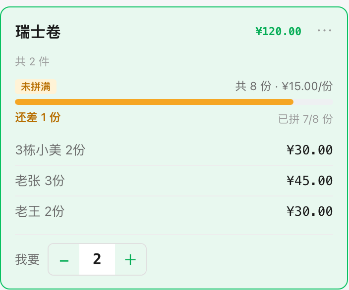
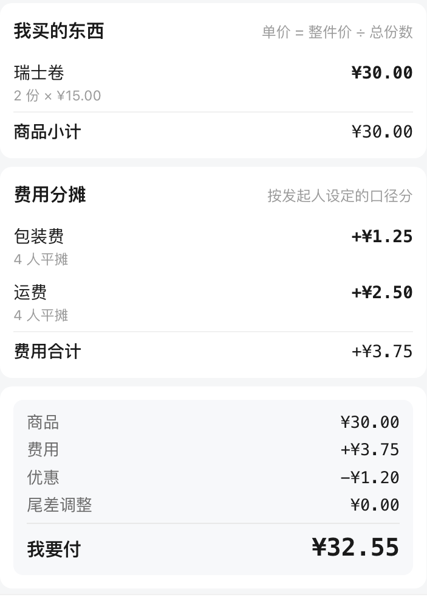
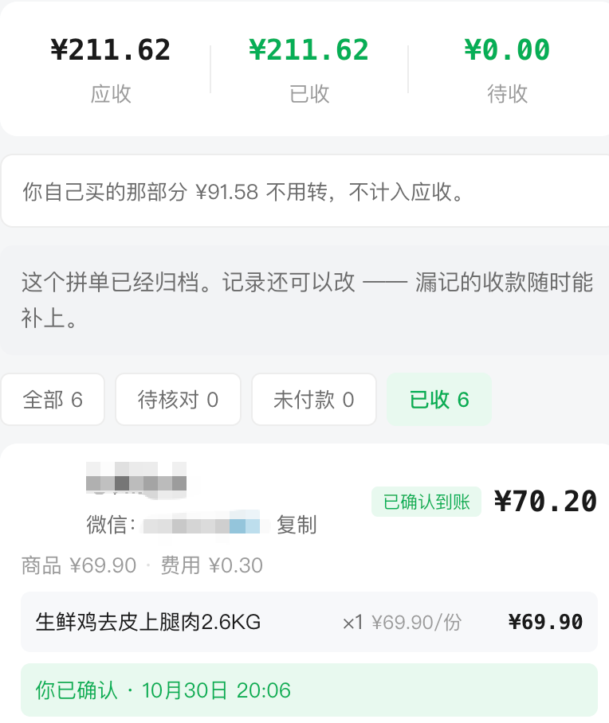
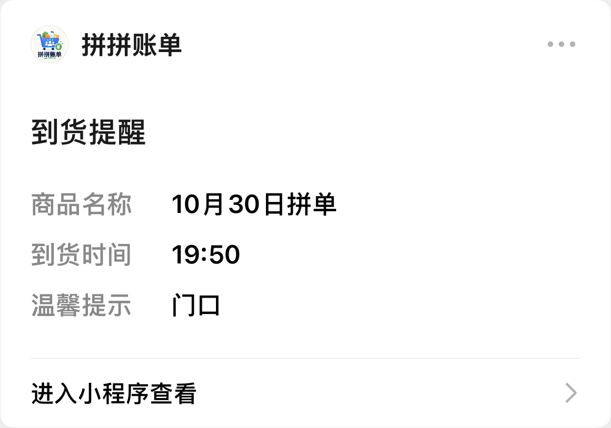

看到了太多食品安全相关的新闻，后来开通了山姆会员，买下来感觉还不错

不管是我平时买的17.9元的鲜牛奶、21.8元30枚的鸡蛋，还是水果和零食，都挺满意

不过分量确实大，我这边下单还要凑满99元才包邮

后来加入小区山姆拼单群，可以和群里的伙伴拼单、凑包邮。但随之而来的问题是：

每次发完消息，群里就不断有人回复、@我

下单前，要翻聊天记录，确认大家买什么，还有哪些没拼满

买完之后，要算每个人付多少钱、包装费和运费怎么分，最后还得提醒大家来取货……

有一天，我突然想到，是不是可以用 Workbuddy 手搓一个小程序，来解决这个问题？

于是花了几天的调试、审核，小程序“拼拼账单”终于正式上线了

分享到群里后，收到了不少好评，连群里的外国友人都在使用

那么它解决了什么问题呢？

## 01 谁要买什么，大家自己填

群友自己添加物品、认领份数；发起人可以配置常购清单，群友也可以添加自己的常购物品

大份商品支持拆分后拼单，比如一盒瑞士卷，可以拆成几份，大家选择自己要的份数，页面会实时显示还差多少没拼满

拆成几份，大家各自认领｜旧版界面示意

遇到限购商品，发起人可以按实际限制，在首页「常购物品」里设置限购件数

比如给小码鸡蛋、大码鸡蛋各设「限购 2 件」，配置一次，之后自己发起的拼单继续使用

群友仍能自由添加，同款商品在整单里共用限购额度，小码、大码分别计算

## 02 每个人该付多少，自动算清楚

认领时能看到自己买了什么、商品合计多少；生成账单后，再看包含费用和优惠的最终应付金额

运费和包装费，可以选择怎么分。发起人填好运费、包装费，可以按购买人数均摊，也可以按购买金额比例分

个人账单示例｜旧版界面

## 03 谁的钱到了，一眼看清

谁的钱到了、谁还差着，首页卡片上直接写。待收金额和未付人数一目了然，发起人不用再点两层才看得到

小程序只负责计算和记录，大家自行转账，发起人核实到账后，再在小程序里确认

收款管理：这单已经收齐

## 04 货到了，一键喊人

支持群友订阅通知，订阅过提醒的群友会收到微信通知；没订阅的人，详情页上也一直挂着取货时间和地点

群友收到的到货提醒

---

从有这个想法，到学习小程序开发、上架流程，再到测试上线，前后花了大概一个星期，主要时间花在等小程序备案

费用主要是30元的小程序认证费，消耗的 token 没有统计

如果你也经常和邻居、朋友拼单，欢迎体验使用～

{: width="220" }

长按识别，打开拼拼账单

\*原文链接：[为了和邻居拼山姆，我用 AI 做了个小程序](https://mp.weixin.qq.com/s/BI0j5pprqS27tmTkEGmKbA)
{: .post-source }
