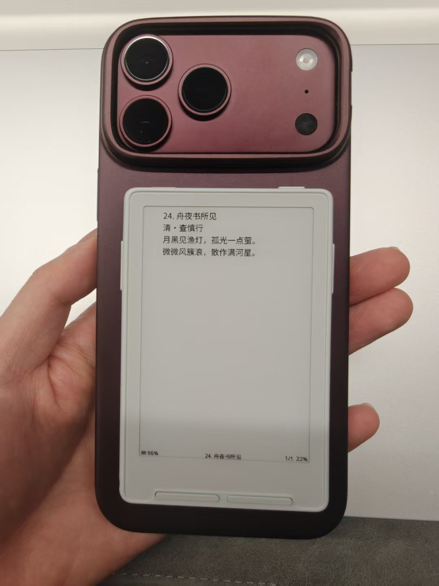
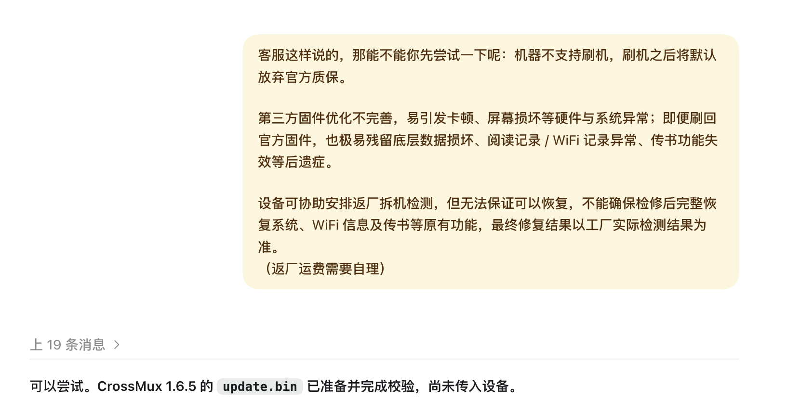
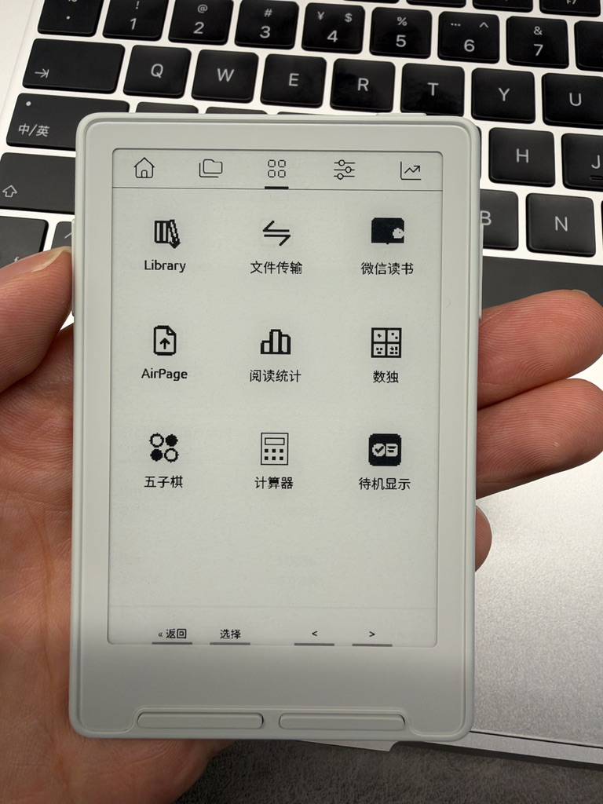
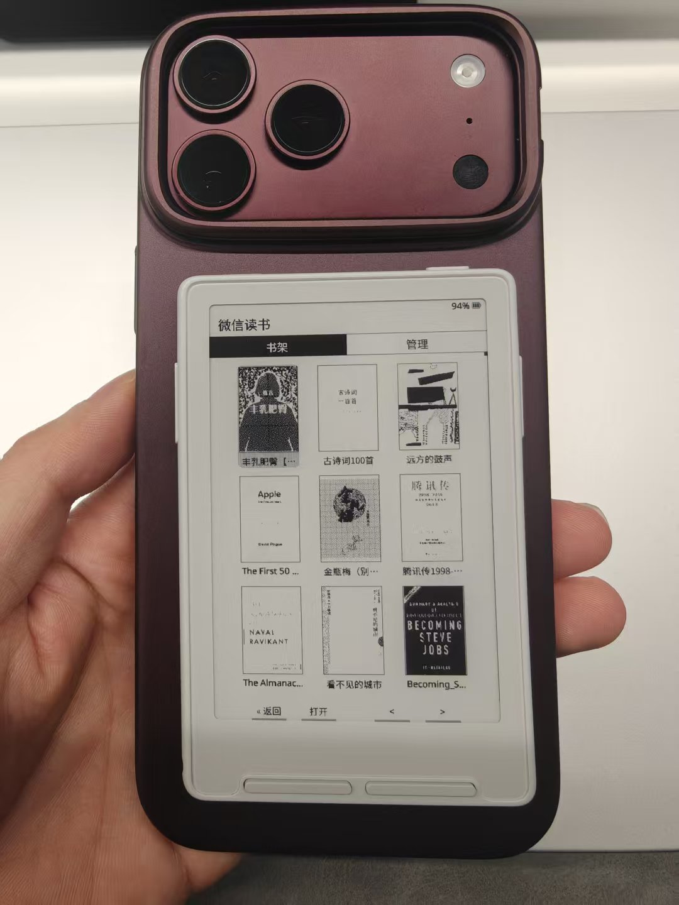
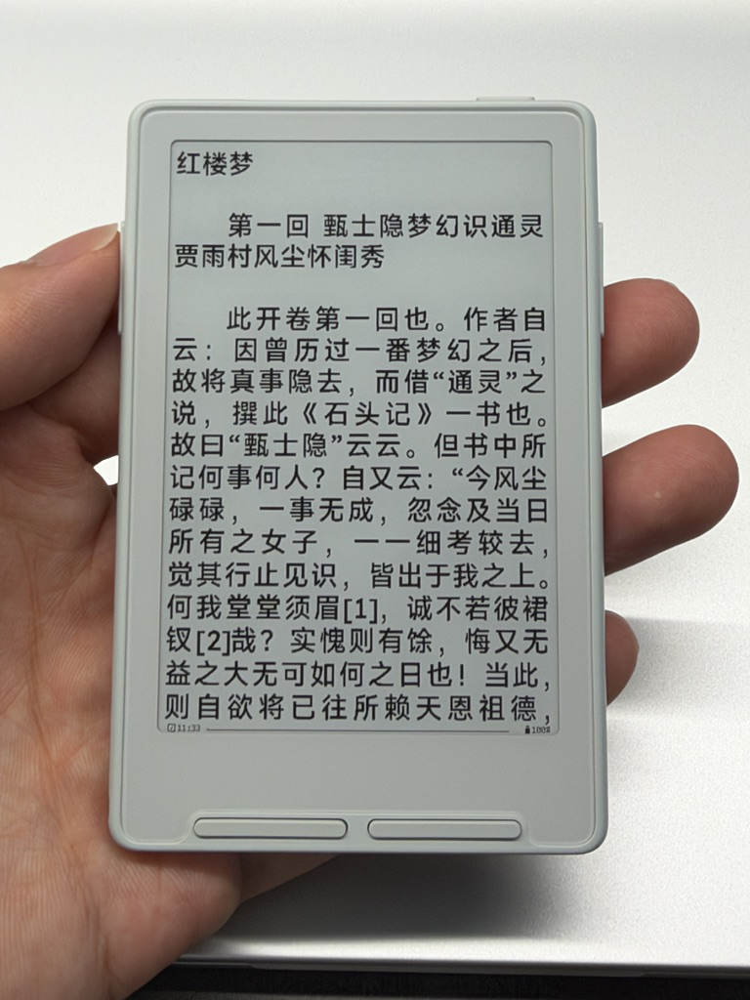
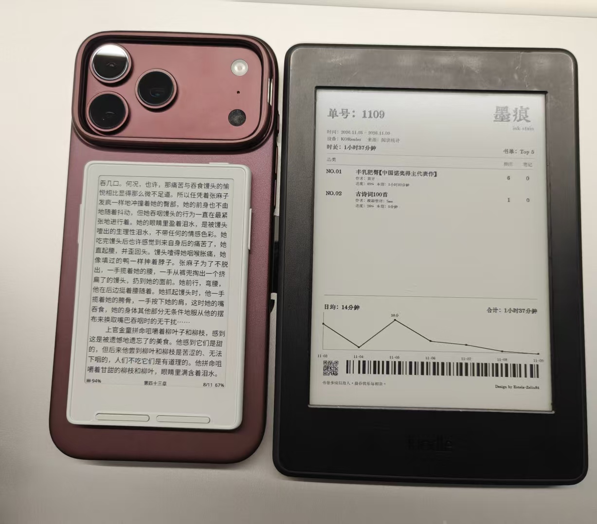
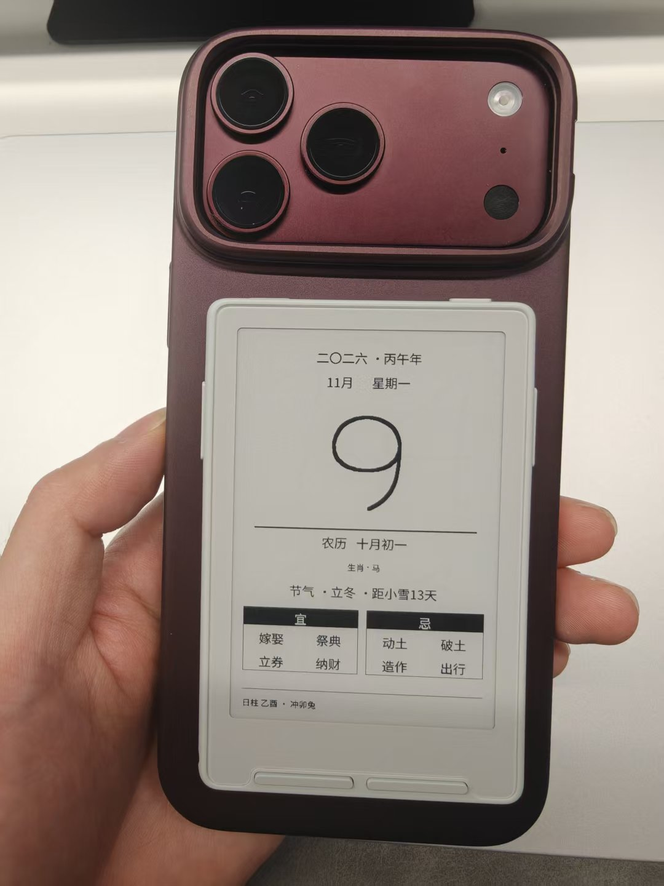

今天给大家分享一款mini墨水屏，3.7英寸，只有1张房卡大小，支持磁吸，贴合在iPhone上，还挺好看的
{: width="471" }

这款墨水屏的品牌是XTEINK阅星瞳，型号是X3，双十一225入手，拿到手后，发现只能使用自带系统，但是搜了一下，发现可以刷CrossMux系统，支持微信读书，这不得折腾一下

和ai交流了一下，ai很没信心，要确认版本、验证是否有锁。联系客服，客服表示不支持刷机，刷后也不保修。但是，我不服气。给ai发出指令：“没有关系，请执行刷机”

{: width="561" }

经过了1个小时的折腾，刷机成功，屏幕出现了第三方UI，支持微信读书

{: width="466" }

扫码，登录，下载书籍，体验了一下，还是挺有意思的
{: width="472" }

使用了一下午，感受如下：
非常小巧精美，磁吸在手机上，好看。看看时间，偶尔看看书，还是有点意思的

{: width="467" }

缺点呢
只支持按键，操作起来也有些卡顿。不管是离线下载书籍，还是使用微信读书，总感觉慢半拍：
按键反馈有延迟，下载书籍很慢，翻页也是

感觉比我那台用了10年、越狱过的 Kindle还要差
如果用来读书，对于我这种急性子的人来说，还是算了
{: width="504" }

如果要一句话总结的话，我觉得是“美丽小废物”，当做装饰品是没问题的，提供情绪价值，还是可以的

{: width="484" }

好了，这就是我的第一期开箱。平时我也喜欢折腾各种数码产品和软件，后面也会不定期分享自己的使用体验，欢迎关注我的公众号

\*原文链接：[01｜阅星瞳 X3墨水屏，美丽小废物](https://mp.weixin.qq.com/s/oQqg2Ni9qfuDhDera3rOdw)
{: .post-source }

---

**关于我**  
旅行、跑步、看书，也喜欢 AI 和数码

🌍 30+ 国家 · 🏅 半马 1h36 ｜ 全马 3h58

[主页 scond.me](https://scond.me)

